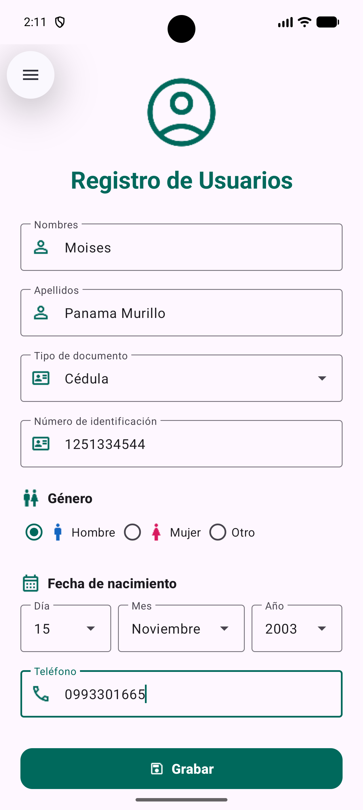
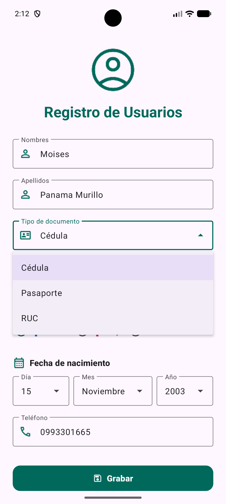
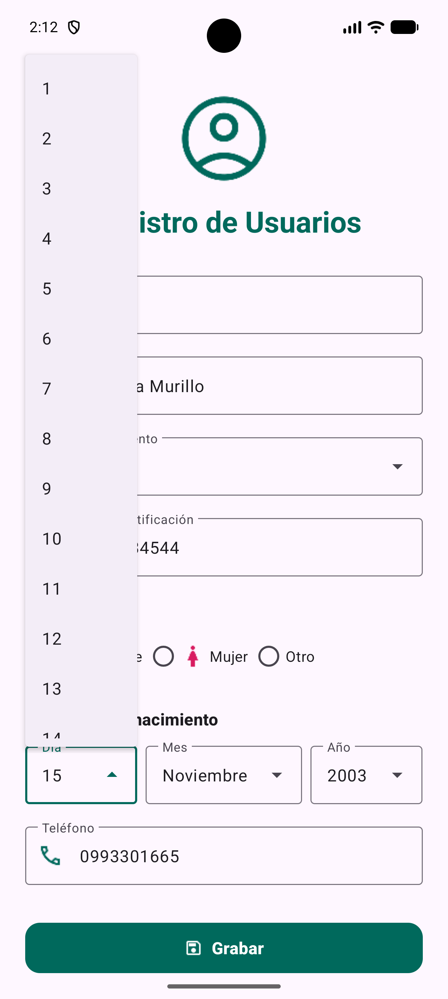
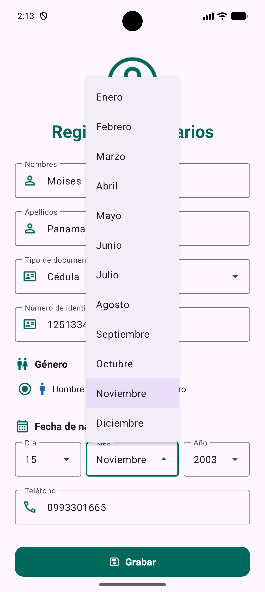
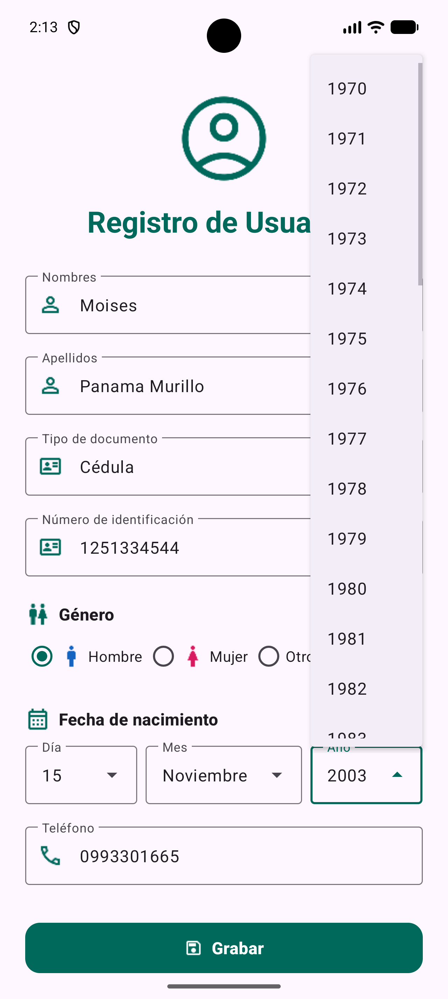

# Práctica 2 – Registro de Usuarios

**Estudiante:** Moisés Panamá · mpanamam@uteq.edu.ec<br>
**Asignatura:** Aplicaciones Móviles – UTEQ 2026<br>
**Repositorio:** [Practica-2-registro-de-usuario](https://github.com/MoisesPanama/Practica-2-registro-de-usuario)

Aplicación Android desarrollada en Kotlin para la práctica de **diseño responsivo de interfaces de usuario** con `ConstraintLayout` y Material Components.

## Objetivo de la práctica

Aplicar los conceptos básicos de Android vistos en clase:

- Construir una interfaz con `ConstraintLayout`.
- Utilizar un `ScrollView` para adaptar el formulario a distintas alturas de pantalla.
- Implementar componentes de Material Design (`TextInputLayout`, menús desplegables y botones).
- Organizar los textos y las opciones en recursos de Android.
- Utilizar iconos almacenados en `res/drawable`.

## ¿Qué hace?

La aplicación presenta un formulario de registro de usuarios en una sola pantalla. El contenido se encuentra dentro de un `ScrollView` para que pueda desplazarse en dispositivos pequeños y utiliza campos Material con bordes outline.

### Campos del formulario

- Nombres y apellidos.
- Tipo de documento: cédula, pasaporte o RUC.
- Número de identificación.
- Género: hombre, mujer u otro.
- Fecha de nacimiento mediante menús desplegables de día, mes y año.
- Teléfono.
- Botón **Grabar**.

El botón forma parte únicamente del diseño de la interfaz, ya que la práctica está enfocada en la construcción y adaptación visual de la pantalla.

## Tecnologías

| Tecnología | Uso en el proyecto |
| --- | --- |
| Kotlin | Lenguaje de programación de la aplicación. |
| Android Studio | Entorno de desarrollo. |
| ConstraintLayout | Organización de los elementos de la pantalla. |
| Material Components | Campos de texto, menús desplegables y botón con estilo Material 3. |
| ScrollView | Desplazamiento del formulario en pantallas pequeñas. |
| Android SDK 37 | `compileSdk` y `targetSdk` del proyecto. |
| minSdk 24 | Compatibilidad desde Android 7.0. |

## Requisitos

- Android Studio instalado.
- JDK 11 (configurado en el proyecto).
- Android SDK 37.
- Emulador o dispositivo físico con Android 7.0 (API 24) o superior.

## Estructura del proyecto

```text
Practica2/
├── app/src/main/
│   ├── java/com/example/practica2/
│   │   └── MainActivity.kt          # Carga la pantalla principal
│   ├── res/
│   │   ├── drawable/                # Iconos del formulario
│   │   ├── layout/
│   │   │   └── activity_main.xml    # Diseño del registro
│   │   ├── values/
│   │   │   ├── arrays.xml           # Opciones de los desplegables
│   │   │   ├── colors.xml           # Paleta de colores
│   │   │   ├── strings.xml          # Textos de la interfaz
│   │   │   └── themes.xml           # Tema de la aplicación
│   │   └── values-night/
│   │       ├── colors.xml           # Colores para modo oscuro
│   │       └── themes.xml           # Tema para modo oscuro
│   └── AndroidManifest.xml
├── evidencias/                      # Capturas de pantalla
├── README.md
└── build.gradle.kts
```

## Recursos gráficos

| Recurso | Uso en el formulario |
| --- | --- |
| `account_circle.png` | Icono del encabezado. |
| `person.png` | Campos de nombres y apellidos. |
| `id_card.png` | Tipo y número de identificación. |
| `wc.png` | Sección de género. |
| `man.png` | Opción Hombre. |
| `woman.png` | Opción Mujer. |
| `calendar_month.png` | Sección de fecha de nacimiento. |
| `phone.png` | Campo de teléfono. |
| `save.png` | Icono del botón Grabar. |

## Cómo ejecutar

1. Clona el repositorio:
   ```bash
   git clone https://github.com/MoisesPanama/Practica-2-registro-de-usuario.git
   ```
2. Abre la carpeta del proyecto en Android Studio.
3. Espera a que Gradle sincronice las dependencias.
4. Ejecuta la aplicación en un emulador o dispositivo con **Run ▶**.

También puedes compilar desde la terminal:

```bash
# Windows
.\gradlew.bat assembleDebug

# Linux / macOS
./gradlew assembleDebug
```

El APK de depuración se genera en:

```text
app/build/outputs/apk/debug/app-debug.apk
```

## Evidencias

Capturas tomadas desde el emulador con el formulario completado y los menús desplegables en funcionamiento.

### Formulario completado

<p align="center">
  
</p>

### Menús desplegables

| Tipo de documento | Día | Mes | Año |
|:---:|:---:|:---:|:---:|
|  |  |  |  |

## Alcance de la práctica

- El proyecto corresponde únicamente al diseño de la pantalla de registro.
- No incluye autenticación real, base de datos ni conexión con un servidor.
- El botón **Grabar** es demostrativo y no guarda información.

## Verificación

- Compilación correcta con `.\gradlew.bat assembleDebug`.
- Análisis de lint sin errores.
